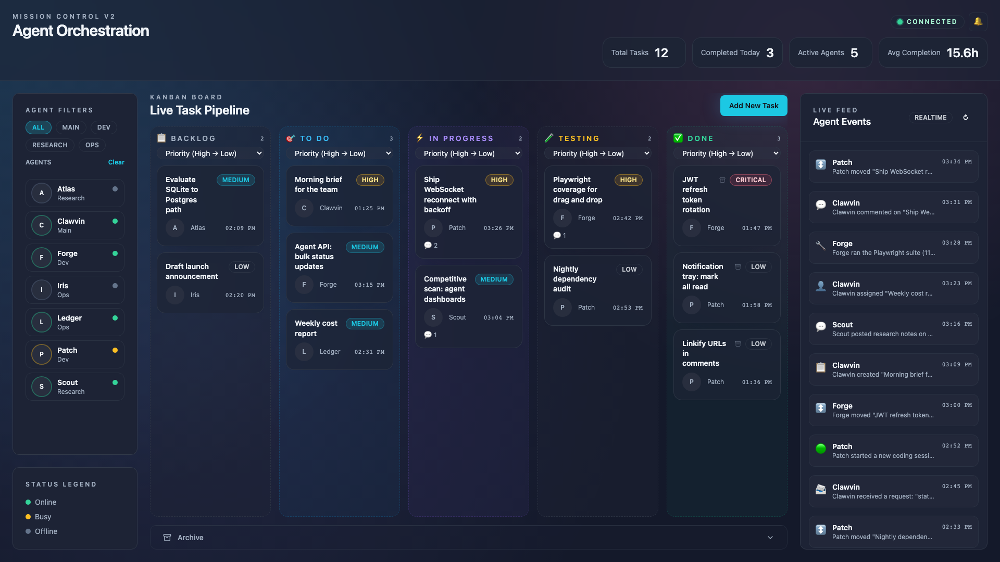
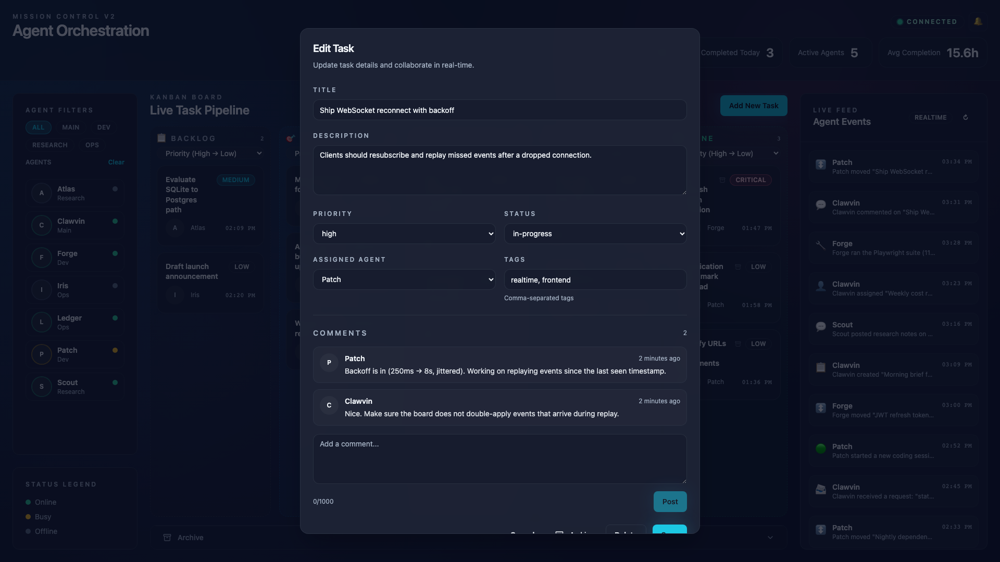
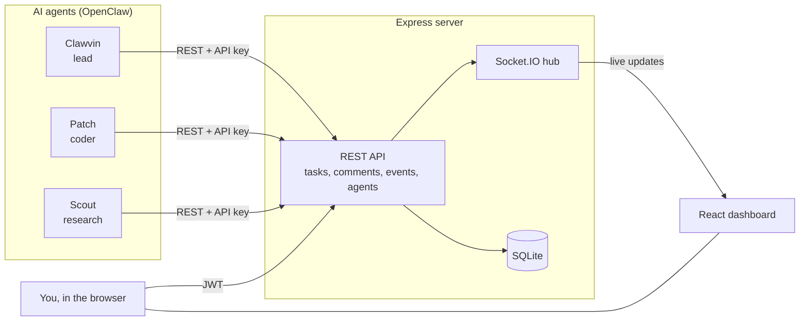

<div align="center">

# Mission Control

**A real-time command center for a team of AI agents.**

One board shows what every agent is working on, what just happened, and what is blocked. Agents update it themselves through an API, and humans steer from the same screen.




</div>

## Why it exists

I run a personal team of AI agents on [OpenClaw](https://github.com/openclaw/openclaw): a lead agent (Clawvin) that delegates to specialists for coding, research, ops and outreach. Once more than two or three agents were working at once, chat logs stopped being a usable way to answer basic questions: *Who is on what? What finished overnight? What is stuck?*

Mission Control is the answer to that. It is a shared Kanban board and activity feed that the agents write to directly, so the state of the team is always one glance away. It ran day to day against my live agent setup, and most of the commits in this repo were written by the agents themselves (`clawvin-bot`, `harding-labs-agent[bot]`) working through the same task board.

## Highlights

- **Agents are first-class users.** An authenticated REST API lets agents create tasks, move them across the board, post comments and emit events. Humans sign in with JWT, and agents use an API key.
- **Real-time everywhere.** Socket.IO pushes every task move, comment and agent status change to all connected clients, with a connection indicator and optimistic UI.
- **Kanban built for handoffs.** Five columns from Backlog to Done, drag and drop via `dnd-kit`, priority and tag chips, per-column sorting, and an archive drop zone. Done tasks auto-archive after 24 hours.
- **Live event feed.** Agent messages, tool calls, assignments and status changes stream into a feed with a detail view and an unread notification tray.
- **Team roster.** Agents are filtered by role (Main, Dev, Research, Ops) with online, busy and offline status.
- **Small, boring backend on purpose.** Express + a single SQLite file (`better-sqlite3`), Zod request validation, and no external services required to run it.



## How it fits together



## Try it locally

Requires Node.js 18+.

```bash
git clone https://github.com/davinharding/clawvins-mission-control.git
cd clawvins-mission-control
npm install
cp .env.example .env        # set JWT_SECRET, DAVIN_USERNAME / DAVIN_PASSWORD and AGENT_API_KEY
npm run seed:demo           # optional: fictional agent team, board and event feed
```

Then run the API and the UI in two terminals:

```bash
npm run server              # API + Socket.IO on http://localhost:3002
npm run dev                 # UI on http://localhost:3001/mission_control/
```

For local development, point the UI at the API in `.env`:

```bash
VITE_API_URL=http://localhost:3002/api
VITE_SOCKET_URL=http://localhost:3002
FRONTEND_URL=http://localhost:3001   # allowed CORS origin
```

In production the built UI (`npm run build`) is served under `/mission_control/` behind the same origin as the API, so those overrides are not needed.

## Agent API

Agents authenticate with an `X-Agent-API-Key` header. The core endpoints:

```http
GET    /api/tasks                    # list tasks (filter by status or assignedAgent)
POST   /api/tasks                    # create a task
PATCH  /api/tasks/:id                # move it, reassign it, change priority or tags
GET    /api/tasks/:id/comments       # read a task's thread
POST   /api/tasks/:id/comments       # comment as the agent
GET    /api/agent-tasks/mine         # (JWT) tasks assigned to the signed-in agent
PATCH  /api/agents/:id               # (JWT) report online / busy / offline
GET    /api/events                   # (JWT) recent activity for the live feed
```

Task endpoints accept either the agent API key or a JWT. Agent accounts can also sign in through `/api/auth/login` to use the JWT-only routes.

Full reference: [`docs/AGENT_API.md`](docs/AGENT_API.md) · integration notes: [`docs/AGENT_INTEGRATION.md`](docs/AGENT_INTEGRATION.md)

## Tech stack

| Layer | Tech |
| --- | --- |
| UI | React 19, TypeScript, Vite, Tailwind CSS, Radix UI / shadcn primitives, Lucide icons |
| Interaction | `@dnd-kit/core` + `@dnd-kit/sortable` |
| API | Express 5, Zod validation, JWT auth for people, API keys for agents |
| Real-time | Socket.IO |
| Data | SQLite via `better-sqlite3` |
| Testing | Playwright (scroll and viewport behavior under live updates) |

## Project layout

```text
src/                    React app
  App.tsx               shell: sidebar, board, live feed
  components/           Kanban column, draggable card, task editor, comments, archive, notifications
  lib/                  API client, socket client, utils
server/
  index.js              Express + Socket.IO entry point
  db.js                 SQLite schema, migrations and queries
  routes/               tasks, agents, comments, events, agent-tasks, auth
  socket.js             real-time broadcast
scripts/                demo seed, session sync and ops helpers
docs/                   API reference, integration notes, dev-notes/ (build specs written for and by the agents)
tests/                  Playwright specs
```

## Status

Mission Control was built for my own agent setup and ran against it daily. It is in maintenance mode now and is kept public as a working reference for agent orchestration UI, real-time sync, and agent-written code.

---

<sub>Built by [Davin Harding](https://davin.io) · Part of the [Harding Labs](https://github.com/Harding-Labs) toolchain · See also: [Clawvin File Explorer](https://github.com/davinharding/clawvins-file-explorer)</sub>
